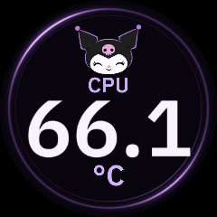

# Kuromi – Alive (Cyclops 240 × 240)

A CPU-only theme with large IBM Plex Sans SemiBold numerals, a real slashed zero,
a violet orbit, and a small blinking/winking mascot. The character gently bobs
and tilts; the temperature stays still. Missing sensor data is displayed as `--`.



## Import and preserve across upgrades

Requires a controller build containing `thermal-orbit` and mascot asset support.
From the extracted release or source tree, while the local controller is running:

```powershell
./scripts/import-kuromi-theme.ps1 -Apply
# If more than one Cyclops is connected:
./scripts/import-kuromi-theme.ps1 -Apply -Serial YOUR_DISPLAY_SERIAL
```

Without `-Apply`, this saves the theme without changing the active display.
The importer uploads the bundled sheet and replaces the portable asset placeholder
with the controller's own asset ID. No user account, hardware serial or API token
is stored in the theme. Reimporting replaces the named `kuromi-alive` layout;
it leaves other saved layouts intact and reuses the versioned sprite asset.

For smooth animation, merge `"frame_interval": "125ms"` into your existing
`%LOCALAPPDATA%/JonsboResurrection/config.json`, then restart the tray application.
Do not overwrite other configuration keys. CLI users can use `--frame-interval 125ms`.
This changes display output frequency, not hardware sensor sampling.

Normal upgrades preserve `%LOCALAPPDATA%/JonsboResurrection/configurator/` and
`config.json`. Back those up before replacing the application. The upgraded
binary must include this feature: an older build does not understand the custom
widget or the 125 ms interval. Keeping files on GitHub alone does not make an
upstream release support them; this change must be merged and released first.
The portable files here allow the same theme to be restored on another supported
installation without reusing a machine-specific asset ID.

## Motion and shutdown

The sheet contains open eyes, a blink and a wink in three equal square cells.
Idle expressions repeat over 24 seconds, with uneven blink spacing and an
occasional double blink. Set the overlay's `animate` to false to freeze idle motion.

On graceful exit, readings fade, the mascot moves into the center and grows
inside the orbit, then winks and closes its eyes. The 1.5-second transition uses
13 frames; the output worker keeps USB open until the sequence finishes.
The sequence has a two-second deadline that cancels pending HID transfers.
Windows I/O cancellation is drained before its buffers and handle are released;
an unresponsive kernel driver can delay that cleanup. Windows `WM_ENDSESSION` waits for bounded
child cleanup before the tray releases its job, with a three-second limit.
An aborted end-session message does not trigger cleanup. Forced process termination
or loss of USB power cannot guarantee a farewell.

Verified on a physical Cyclops: live temperatures, idle animation, graceful
exit with `live → stopping → stopped`, and saved-theme restoration on restart.
The whole PC was not shut down as part of the live test.

## Artwork and font

`expressions.png` is a generated fan-art sprite sheet made with the built-in
imagegen tool; the exact prompt is in `art-prompt.txt`. Kuromi is a Sanrio character;
this project and this optional theme are not affiliated with or endorsed by Sanrio.
The character is not claimed as an original project-owned or MIT-licensed character.

IBM Plex Sans is under the SIL Open Font License. The atlas, provenance, generator
and license are in `modules/configurator/fonts/` and `scripts/make-plex-dial-font.py`.
The runtime requires no installed font or Python dependency.
